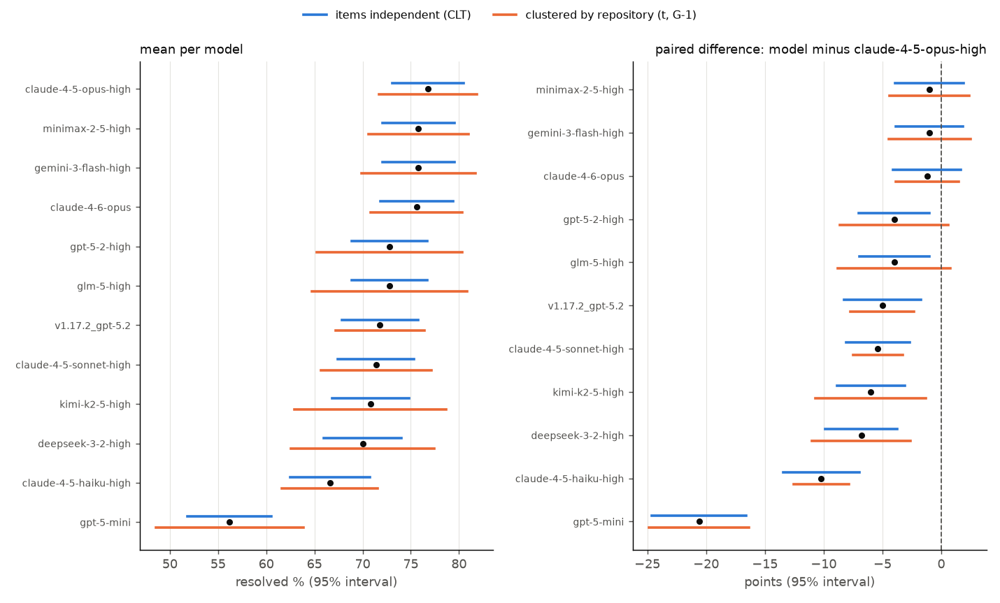

# evalstats

Error bars, paired comparisons and sample-size planning for model evaluations
scored per item.

## Why this is hard

Two models scored on the same benchmark almost never get the same number, and
the gap is often smaller than the noise in either number. A benchmark is a
sample of items; the items are not independent (on SWE-bench Verified, 231 of
the 500 issues come from one repository); and when two models are evaluated on
the same items, the right question is not whether their two intervals overlap
but whether the items on which they disagree lean consistently one way. A
3-point gap can be strong evidence of a real difference on one benchmark and no
evidence at all on another, depending on how many items the two models disagree
on and how those items are spread over repositories. Then a leaderboard asks the
question 66 times at once for 12 models, and some answers come out "significant"
by chance. evalstats computes the quantities that separate these cases from the
per-item results alone.

## Install

```
pip install git+https://github.com/vipul21435/evalstats
```

Python 3.10 or newer; the dependencies are numpy and scipy. The plotting example
also needs matplotlib.

## Quickstart

The input is a JSONL or CSV file with one row per item and model: `item`,
`model`, `score` (0/1 or real) and an optional `cluster` column. With
`--cluster-by-prefix` the cluster is the part of the item id before the first
`__`, the convention SWE-bench uses to prefix instance ids with their source
repository. For pass@k a row can carry `n_samples` and `n_correct`, or the file
can hold one row per sample; the other commands score such an item by the mean
of its rows (the per-item pass@1 estimate) and keep the item as the unit of
resampling.

`examples/make_fixture.py` writes a synthetic file with three models on 120
items in 8 clusters. Model `b` is model `a` with six extra solves; model `c` is
drawn independently with the same per-cluster rates. `sh examples/run.sh` runs
every command below.

```
$ evalstats summary examples/results.jsonl --cluster-by-prefix --method bca
| model | n | clusters | mean % | 95% low | 95% high | method |
|---|---:|---:|---:|---:|---:|---|
| a | 120 | 8 | 43.3 | 34.4 | 53.1 | bca |
| b | 120 | 8 | 48.3 | 39.1 | 60.6 | bca |
| c | 120 | 8 | 46.7 | 31.5 | 60.5 | bca |
```

Each model's interval is about 20 points wide and all three overlap. The paired
comparison separates the two pairs:

```
$ evalstats compare examples/results.jsonl --a a --b b
shared items: 120
a: 43.3 %
b: 48.3 %
difference (a - b): -5.0 points, 95% interval [-8.9, -1.1] (clt)
sign-flip permutation p: 0.0332
McNemar exact: a-only 0, b-only 6, discordant 6, p = 0.0312

$ evalstats compare examples/results.jsonl --a a --b c
shared items: 120
a: 43.3 %
c: 46.7 %
difference (a - b): -3.3 points, 95% interval [-15.4, 8.7] (clt)
sign-flip permutation p: 0.6860
McNemar exact: a-only 25, b-only 29, discordant 54, p = 0.6835
```

`b` beats `a` by 5 points on 6 discordant items, all in the same direction: the
paired interval excludes zero. `c` beats `a` by 3.3 points on 54 discordant
items that split 25 to 29: no evidence of a difference. The marginal intervals
cannot tell these cases apart; the paired analysis can.

Treating the 8 clusters as the unit of sampling changes the first answer:

```
$ evalstats compare examples/results.jsonl --a a --b b --cluster-by-prefix
shared items: 120
a: 43.3 %
b: 48.3 %
difference (a - b): -5.0 points, 95% interval [-10.3, 0.3] (clt)
sign-flip permutation p: 0.0332
cluster sign-flip p (8 clusters): 0.1250
McNemar exact: a-only 0, b-only 6, discordant 6, p = 0.0312
```

The six extra solves fall in only four clusters, and with four clusters no
cluster-level test can go below `2 / 2**4 = 0.125`. Whether that matters depends
on the question: McNemar asks whether `b` beats `a` on these 120 items; the
clustered analysis asks whether it would on a fresh draw of repositories.

How many items would a 3-point difference need, at the discordance observed
between `a` and `b`?

```
$ evalstats power examples/results.jsonl --a a --b b --delta 0.03
shared items: 120
observed discordance: 5.0 % of items
sd of per-item differences: 0.2189
design effect from clusters: 1.00
items to detect 3.0 points at alpha 0.05, power 0.8: 434 (independent items), 434 (with the design effect)
power for 3.0 points on the observed 120 items: 0.32
smallest difference detectable on 120 items: 5.6 points
```

Before any data exist, the same formula runs from an assumed discordance:

```
$ evalstats power --discordance 0.12 --delta 0.03
items to detect 3.0 points at alpha 0.05, power 0.8, discordance 12.0 %: 1045
```

`evalstats leaderboard` ranks every model and tests every pair with Holm and
Benjamini-Hochberg corrections; `evalstats report` writes the ranking, the
pairwise table and power plans for neighbouring models as one Markdown (or
`--json`) document; `evalstats passk` computes pass@k. Every command takes
`--json` and `--out FILE`.

## How it works

Notation: `n` items, scores `x_i`, mean `x̄`, `G` clusters.

- **CLT interval**: `x̄ ± z · se` with `se = sd / sqrt(n)`.
- **Cluster-robust standard error**: residuals `x_i - x̄` are summed within each
  cluster and `se² = G / (G - 1) · Σ_g (Σ_{i∈g} (x_i - x̄))² / n²` (the
  sandwich estimator for a mean; Cameron and Miller 2015 survey it and its
  problems with few clusters). With one item per cluster it equals the plain
  standard error. With clusters the critical value is the `t` quantile with
  `G - 1` degrees of freedom instead of `z`, because the variance is estimated
  from only `G` cluster sums; with 12 clusters this widens a 95 % interval by
  12 %. A seeded simulation in the tests (20 unequal clusters with a shared
  cluster effect, 400 replications) gives 33 % coverage for the item-level 90 % interval and
  86 % for the cluster-robust one.
- **Percentile bootstrap**: resample items, or whole clusters when a cluster key
  is given, with replacement; take the `α/2` and `1 - α/2` quantiles of the
  resampled means.
- **BCa bootstrap**: the percentile bootstrap with a bias correction
  `z0 = Φ⁻¹(share of resampled means below x̄, ties counted at half weight)`
  and an acceleration `a` from
  the jackknife (over items, or over clusters) skewness of the mean, as in
  Efron 1987. A degenerate bootstrap falls back to the percentile bounds.
- **Paired difference**: a one-sample interval, by any method above, on the
  per-item differences `d_i = a_i - b_i`. Pairing removes the item difficulty
  that both models share, which is why the paired interval is much narrower than
  the two marginal ones.
- **Exact McNemar** (McNemar 1947): for 0/1 scores let `b` count items only
  model A solved and `c` items only model B solved. Under the null the
  discordant items split as `Binomial(b + c, 1/2)`; the two-sided p-value is
  `min(1, 2 · P(X ≤ min(b, c)))`. Items both models solve or both fail carry no
  information about which is better.
- **Sign-flip permutation test**: flip the sign of each `d_i` at random,
  recompute `|mean(d)|`, and report `(count + 1) / (n_perm + 1)` for the share
  at least as extreme as observed. Works for real-valued scores.
- **Cluster sign-flip test**: sum `d_i` within each cluster and flip the signs
  of whole clusters. With `G ≤ 16` all `2^G` patterns are enumerated, so the
  p-value is exact; above that, patterns are sampled. The smallest attainable
  p-value is `2 / 2^G'`, where `G'` counts clusters with a non-zero sum.
- **Holm** (Holm 1979): sort the `m` p-values, multiply the `i`-th smallest
  (from 0) by `m - i`, take a running maximum, cap at 1. Controls the
  probability of any false "these two differ".
- **Benjamini-Hochberg** (Benjamini and Hochberg 1995): multiply the `i`-th
  smallest (from 1) by `m / i`, take a running minimum from the top, cap at 1.
  Controls the expected share of false claims among the claims made.
- **Top group**: the models whose Holm-adjusted p-value against the leader is
  at least `α`, that is, the models the data cannot separate from first place.
- **Sample size from discordance**: with a share `ψ` of discordant items and a
  true difference `δ`, the per-item difference has variance `ψ` under the null
  and `ψ - δ²` under the alternative, so a two-sided test at level `α` with
  power `1 - β` needs
  `n = (z_{1-α/2} · sqrt(ψ) + z_{1-β} · sqrt(ψ - δ²))² / δ²` items. For real
  scores `n = ((z_{1-α/2} + z_{1-β}) · sd(d) / δ)²`. The design effect is
  `(clustered se / plain se)²` of the differences; the clustered plan
  multiplies `n` by `max(1, design effect)`, since a design effect below 1
  from a dozen clusters is more likely noise than a real gain. A seeded
  simulation in the tests checks that benchmarks of the planned size reach
  close to the target power with the exact McNemar test (the exact test is
  slightly conservative).
- **pass@k**: per item `1 - C(n - c, k) / C(n, k)` for `c` correct out of `n`
  samples, the unbiased estimator of Chen et al. 2021, averaged over items, with
  a percentile bootstrap over items.

Miller 2024 makes the general case for treating evaluations as experiments with
standard errors, clustered errors, paired differences and power analysis;
evalstats implements those pieces for per-item result files.

## Results on real public data: when do two different scores not mean two different models?

Data: the per-instance `resolved` flags of 12 SWE-bench Verified submissions in
the public experiments repository, https://github.com/SWE-bench/experiments
(`evaluation/verified/<submission>/per_instance_details.json`). Eleven are the
mini-SWE-agent v2.0.0 runs of different models dated 2026-02-17, plus one
v1.17.2 run. For each submission the fetch script compares the resolved rate
computed from the per-instance file with the rate in the submission's
`metadata.yaml`; all 12 agree within 0.2 points. One more submission,
`20260226_mini-v2.0.0_gemini-3-pro-high`, was left out because its per-instance
file marks all 500 instances unresolved while its metadata reports 69.6 %.

Licence: the experiments repository has no licence file (checked on
2026-11-06: the GitHub API reports no licence for the repository and
`LICENSE` returns 404 on its main branch). Nothing from it is committed here:
`examples/fetch_swebench.py` downloads the files (about 0.7 MB) and only derived
summary numbers appear below. Instance ids are `<owner>__<repo>-<number>`, so
`--cluster-by-prefix` clusters the 500 items into 12 repositories.

Reproduce everything below with:

```
sh examples/swebench.sh ~/data/evalstats
```

In the commands below `F` stands for `~/data/evalstats/swebench_verified.jsonl`,
the file the fetch script writes. Model names in the tables drop the
`mini-v2.0.0_` prefix; `v1.17.2_gpt-5.2` is the
older agent version.

### Intervals for each submission

`evalstats summary F` (items independent) and `evalstats summary F
--cluster-by-prefix` (clustered by repository), CLT, 95 %:

| submission | resolved % | items independent | clustered by repository |
|---|---:|---:|---:|
| claude-4-5-opus-high | 76.8 | 73.1 to 80.5 | 71.7 to 81.9 |
| gemini-3-flash-high | 75.8 | 72.0 to 79.6 | 69.9 to 81.7 |
| minimax-2-5-high | 75.8 | 72.0 to 79.6 | 70.6 to 81.0 |
| claude-4-6-opus | 75.6 | 71.8 to 79.4 | 70.8 to 80.4 |
| glm-5-high | 72.8 | 68.9 to 76.7 | 64.7 to 80.9 |
| gpt-5-2-high | 72.8 | 68.9 to 76.7 | 65.3 to 80.3 |
| v1.17.2_gpt-5.2 | 71.8 | 67.9 to 75.7 | 67.2 to 76.4 |
| claude-4-5-sonnet-high | 71.4 | 67.4 to 75.4 | 65.7 to 77.1 |
| kimi-k2-5-high | 70.8 | 66.8 to 74.8 | 62.9 to 78.7 |
| deepseek-3-2-high | 70.0 | 66.0 to 74.0 | 62.5 to 77.5 |
| claude-4-5-haiku-high | 66.6 | 62.5 to 70.7 | 61.6 to 71.6 |
| gpt-5-mini | 56.2 | 51.8 to 60.6 | 48.5 to 63.9 |

With items treated as independent the half-width is 3.7 to 4.4 points; with
repository clusters it is 4.6 to 8.1 points. Read on the item-level intervals
alone, the top ten submissions, 70.0 % to 76.8 %, all overlap one another.



`docs/swebench_intervals.png`, drawn by `examples/plot_intervals.py` from the
same file: left, each model's mean with both intervals; right, each model's
paired difference from the leader. The paired intervals are narrower than the
marginal ones because both models face the same hard and easy items.

### Two 3-point gaps

Four pairs in this set differ by exactly 3.0 points. Take gemini-3-flash-high
(75.8 %) against glm-5-high (72.8 %):

```
$ evalstats compare F --a mini-v2.0.0_gemini-3-flash-high --b mini-v2.0.0_glm-5-high --cluster-by-prefix
shared items: 500
mini-v2.0.0_gemini-3-flash-high: 75.8 %
mini-v2.0.0_glm-5-high: 72.8 %
difference (a - b): 3.0 points, 95% interval [-0.2, 6.2] (clt)
sign-flip permutation p: 0.0673
cluster sign-flip p (12 clusters): 0.1133
McNemar exact: a-only 36, b-only 21, discordant 57, p = 0.0627
```

The two models disagree on 57 of 500 items and split them 36 to 21. That is
not enough: McNemar gives p = 0.063 before any correction for the other 65
pairs on the board. Without clusters the paired interval is [0.0, 6.0] (the
lower bound is +0.05 points), on the edge of zero; with clusters it is
[-0.2, 6.2]. None of the four 3.0-point pairs reaches p < 0.05 with McNemar
(p = 0.063, 0.067, 0.086, 0.096).

By contrast claude-4-5-opus-high against glm-5-high, 4.0 points apart, splits
58 discordant items 39 to 19: McNemar p = 0.012, cluster sign-flip p = 0.033,
but the cluster-robust t interval [-0.8, 8.8] still covers zero: the design
effect of the difference is 2.08 (`evalstats power F --a ... --b ...
--cluster-by-prefix`), so the clustered standard error is 1.44 times the plain
one, and the `t` quantile with 11 degrees of freedom adds another 12 %.

### How many items a 3-point difference needs

```
$ evalstats power F --a mini-v2.0.0_gemini-3-flash-high --b mini-v2.0.0_glm-5-high --delta 0.03 --cluster-by-prefix
shared items: 500
observed discordance: 11.4 % of items
sd of per-item differences: 0.3366
design effect from clusters: 0.92
items to detect 3.0 points at alpha 0.05, power 0.8: 992 (independent items), 992 (with the design effect)
power for 3.0 points on the observed 500 items: 0.51
smallest difference detectable on 500 items: 4.2 points
```

At the discordance these two models show, detecting a true 3-point difference
with 80 % power needs about 992 items, twice the size of SWE-bench Verified. On
the 500 items available the chance of detecting it is 0.51, and the smallest
difference detectable with 80 % power is 4.2 points. Across the 11 pairs of
neighbours in the ranking (`evalstats report F --cluster-by-prefix`), a 3-point
difference needs 923 to 1742 items assuming independent items and 975 to 2786
after the repository design effect; power on 500 items ranges from 0.22 to
0.52.

### The corrected pairwise table

`evalstats leaderboard F --cluster-by-prefix --against-leader`: the leader
against each other submission, paired difference with the clustered 95 %
interval, exact McNemar, and both corrections over this family of 11 tests.

| a | b | a - b | 95% low | 95% high | p | p Holm | p BH |
|---|---|---:|---:|---:|---:|---:|---:|
| claude-4-5-opus-high | gemini-3-flash-high | 1.0 | -2.5 | 4.5 | 0.5831 | 1.0000 | 0.5901 |
| claude-4-5-opus-high | minimax-2-5-high | 1.0 | -2.4 | 4.4 | 0.5901 | 1.0000 | 0.5901 |
| claude-4-5-opus-high | claude-4-6-opus | 1.2 | -1.5 | 3.9 | 0.4966 | 1.0000 | 0.5901 |
| claude-4-5-opus-high | glm-5-high | 4.0 | -0.8 | 8.8 | 0.0119 | 0.0596 | 0.0185 |
| claude-4-5-opus-high | gpt-5-2-high | 4.0 | -0.6 | 8.6 | 0.0135 | 0.0596 | 0.0185 |
| claude-4-5-opus-high | v1.17.2_gpt-5.2 | 5.0 | 2.3 | 7.7 | 0.0041 | 0.0244 | 0.0075 |
| claude-4-5-opus-high | claude-4-5-sonnet-high | 5.4 | 3.3 | 7.5 | 0.0001 | 0.0010 | 0.0003 |
| claude-4-5-opus-high | kimi-k2-5-high | 6.0 | 1.3 | 10.7 | <0.0001 | 0.0006 | 0.0002 |
| claude-4-5-opus-high | deepseek-3-2-high | 6.8 | 2.6 | 11.0 | <0.0001 | 0.0002 | <0.0001 |
| claude-4-5-opus-high | claude-4-5-haiku-high | 10.2 | 7.8 | 12.6 | <0.0001 | <0.0001 | <0.0001 |
| claude-4-5-opus-high | gpt-5-mini | 20.6 | 16.3 | 24.9 | <0.0001 | <0.0001 | <0.0001 |

The leader is not separated from the next five submissions after Holm, which
spans a 4-point range of scores: claude-4-5-opus-high, gemini-3-flash-high,
minimax-2-5-high, claude-4-6-opus, glm-5-high and gpt-5-2-high form the top
group.

Testing all 66 pairs instead (`evalstats leaderboard F --cluster-by-prefix`):

| per-pair test | pairs with raw p < 0.05 | after BH | after Holm | top group size |
|---|---:|---:|---:|---:|
| exact McNemar (items) | 39 | 37 | 23 | 7 |
| cluster sign-flip (`--test cluster`) | 29 | 22 | 0 | 12 |

Over 66 pairs Holm needs a raw p-value near `0.05 / 66 = 0.00076` for the
smallest one. The cluster sign-flip test over 12 repositories cannot get there:
SWE-bench Verified has two repositories with one and two items, whose sums are
often zero, and the smallest p-value the test reached over the 66 pairs is
0.0020 (8 of the 4096 sign patterns). So
with repositories as the unit of replication, no pair on this board survives
Holm, and the BH count drops from 37 to 22. The 66-pair family also widens the
McNemar top group from 6 to 7 (v1.17.2_gpt-5.2 rejoins it).

What this says about these 12 submissions:

- Gaps of 1 to 1.2 points among the top four are noise on any reading.
- A 3-point gap on SWE-bench Verified is below what 500 items can resolve at
  the discordance these agents show; it would take about 1000 items.
- Gaps of 5 points or more against the leader hold on the item-level analysis
  after Holm over the 11 tests against the leader (over all 66 pairs, the
  5.0-point gap to v1.17.2_gpt-5.2 does not). Whether they would hold on a different set of repositories is a
  separate question that 12 repositories, one of them holding 231 of the 500
  items, can barely answer.

The repository sizes come from the item ids:

```
python -c "import json,sys,collections;c=collections.Counter(json.loads(l)['item'].split('__')[0] for l in open(sys.argv[1]) if '4-5-opus' in l);print(c.most_common(3))" F
[('django', 231), ('sympy', 75), ('sphinx-doc', 44)]
```

## Limitations

- The CLT interval is a normal (or `t`) approximation and is poor for very small
  `n` or means near 0 or 1; use `--method bca` there.
- Cluster-robust errors need tens of clusters to be reliable. With 12 clusters
  of very unequal size, as on SWE-bench Verified, they are themselves noisy;
  the coverage simulation in the tests reaches 86 % for a nominal 90 % interval
  with 20 unequal clusters. Wild cluster bootstrap and small-sample corrections
  beyond `t(G - 1)` are not implemented.
- The cluster bootstrap resamples whole clusters and takes a ratio of sums;
  with one cluster holding nearly half the items its intervals are lopsided:
  `evalstats summary F --cluster-by-prefix --method bca` gives 65.6 to 75.4
  around 71.8 for v1.17.2_gpt-5.2.
- `power` assumes the observed discordance and design effect carry over to the
  new items; it is a planning aid, not a guarantee.
- Pairwise tests in the leaderboard use only the items both models were scored
  on; models scored on different item sets are compared on the overlap.
- No ties-aware or stratified McNemar, no mixed-effects models, no Bayesian
  intervals, and no correction for run-to-run variance of the same model
  (that would need several runs per model; pass@k covers the case where the
  samples are given).
- `passk` resamples items only; it does not model the variance from the finite
  number of samples per item.
- The real-data results are for one benchmark and one agent scaffold.

## Related tools

- [graderguard](https://github.com/vipul21435/graderguard): audit graders for reward hacking and flakiness.
- [taskledger](https://github.com/vipul21435/taskledger): schema validation and lint rules for benchmark-task bundles.
- [rubricops](https://github.com/vipul21435/rubricops): versioned rubrics and inter-rater agreement.
- [prefpairs](https://github.com/vipul21435/prefpairs): pairwise preference data, Bradley-Terry and Elo.

## References

- Jimenez et al. 2023. SWE-bench: Can Language Models Resolve Real-World GitHub Issues? arXiv:2310.06770.
- Miller 2024. Adding Error Bars to Evals: A Statistical Approach to Language Model Evaluations. arXiv:2411.00640.
- Chen et al. 2021. Evaluating Large Language Models Trained on Code. arXiv:2107.03374.
- Efron 1987. Better Bootstrap Confidence Intervals. Journal of the American Statistical Association.
- McNemar 1947. Note on the sampling error of the difference between correlated proportions or percentages. Psychometrika 12(2).
- Holm 1979. A simple sequentially rejective multiple test procedure. Scandinavian Journal of Statistics 6(2).
- Benjamini and Hochberg 1995. Controlling the False Discovery Rate: A Practical and Powerful Approach to Multiple Testing. JRSS B 57(1).
- Cameron and Miller 2015. A Practitioner's Guide to Cluster-Robust Inference. Journal of Human Resources 50(2).

## Licence

MIT. See `LICENSE`.

Built by Vipul Raj Jha · https://vipul21435.github.io
